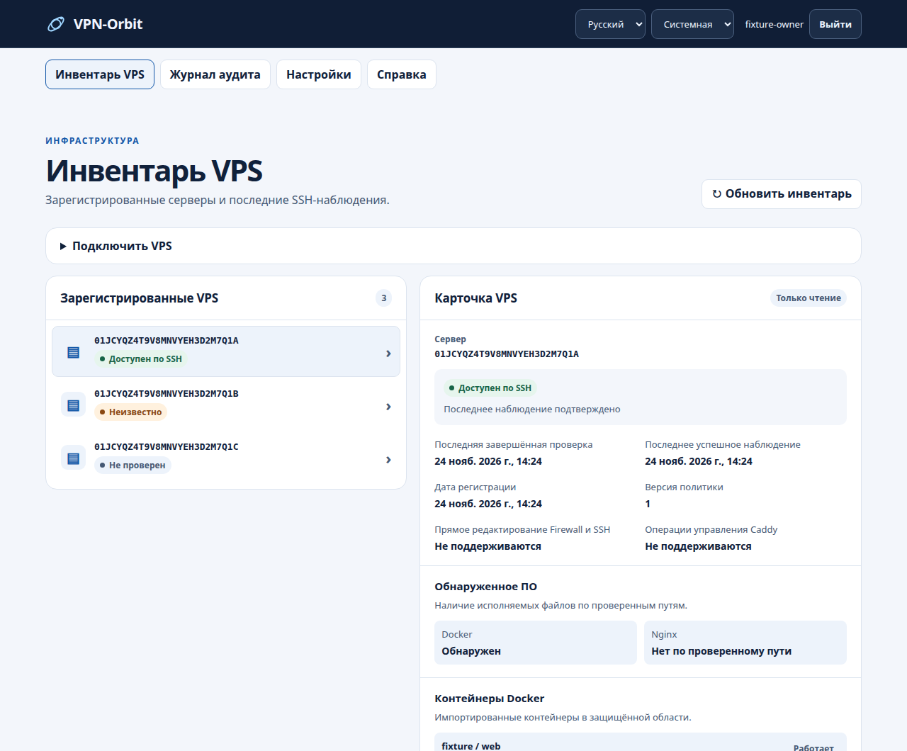

<div align="center">

# VPN-Orbit

**Самостоятельно размещаемая панель для управления подготовленными VPS.**

Проверяйте доступность серверов по SSH, управляйте поддерживаемыми приложениями и просматривайте историю изменений в браузере.

[](https://github.com/RoyMan810/VPN-Orbit/releases/tag/v1.0.0)
[](https://github.com/RoyMan810/VPN-Orbit/actions/workflows/checks.yml)

[Установка](docs/installation.md) · [Управление VPS](docs/vps.md) · [Документация](docs/README.md) · [Roadmap](docs/roadmap.md)

</div>

## Возможности

- **Инвентарь VPS.** Подключайте одобренные серверы с проверкой отпечатка SSH, просматривайте наблюдения, состояние выбранных Docker-контейнеров и их опубликованные порты.
- **Управляемые изменения.** Владелец просматривает и подтверждает план: правила firewall с автоматическим откатом, операции с приложениями или перезапуск специально подготовленного тестового контейнера.
- **Доступ и аудит.** Панель работает по HTTPS, учитывает права на отдельные VPS и сохраняет историю заданий, включая операции с неопределённым результатом.

## Интеграции

| Сервис | Что поддерживается |
| --- | --- |
| Remnawave Panel и Node | Установка, запуск и удаление управляемых профилей; регистрация Node выполняется в Remnawave Panel. |
| Bedolaga Bot и Cabinet | Установка, запуск и удаление управляемых профилей; для Bot доступны polling и Telegram webhook. |

[Требования и настройка приложений](docs/applications.md)

## Веб-интерфейс



Скриншот сделан в работающем WebUI с тестовыми данными.

## Быстрый старт

Для контроллера нужна чистая **Ubuntu Server 24.04 или 26.04 (amd64)** с systemd, `sudo`, Git и доступом в интернет. Для сборки рекомендуется **2 ГиБ памяти и 6 ГиБ свободного места в `/var/lib`**. Если Docker отсутствует, установщик поставит Docker Engine 29.x, Compose и Buildx.

```sh
git clone --branch v1.0.0 https://github.com/RoyMan810/VPN-Orbit.git
sudo ./VPN-Orbit/install
```

Для управления VPS [подготовьте их до установки контроллера](docs/vps.md#подготовка-vps) и передайте политику через `--targets`. Без неё инвентарь будет пустым. Для публичного HTTPS [заранее подготовьте сертификат](docs/installation.md#публичный-https).

При установке задайте пароль владельца (имя по умолчанию — `admin`). Для доступа по умолчанию [добавьте локальный CA в доверенные и откройте SSH-туннель](docs/installation.md#доступ-через-ssh-туннель).

**Границы v1.0.0:** панель не подготавливает произвольные серверы из браузера и не принимает внешние Compose-установки под управление. Автообновление, миграция старой базы и встроенное резервное копирование с восстановлением не предусмотрены.

Для сборок кандидата `v1.1.0` см. [обслуживание и восстановление контроллера](docs/operations.md), [копии приложений](docs/applications.md#резервная-копия-postgresql) и [статус приёмки](docs/roadmap.md#p0--v110-безопасная-эксплуатация-контроллера).

[Обслуживание и диагностика](docs/operations.md) · [Разработка](CONTRIBUTING.md)
